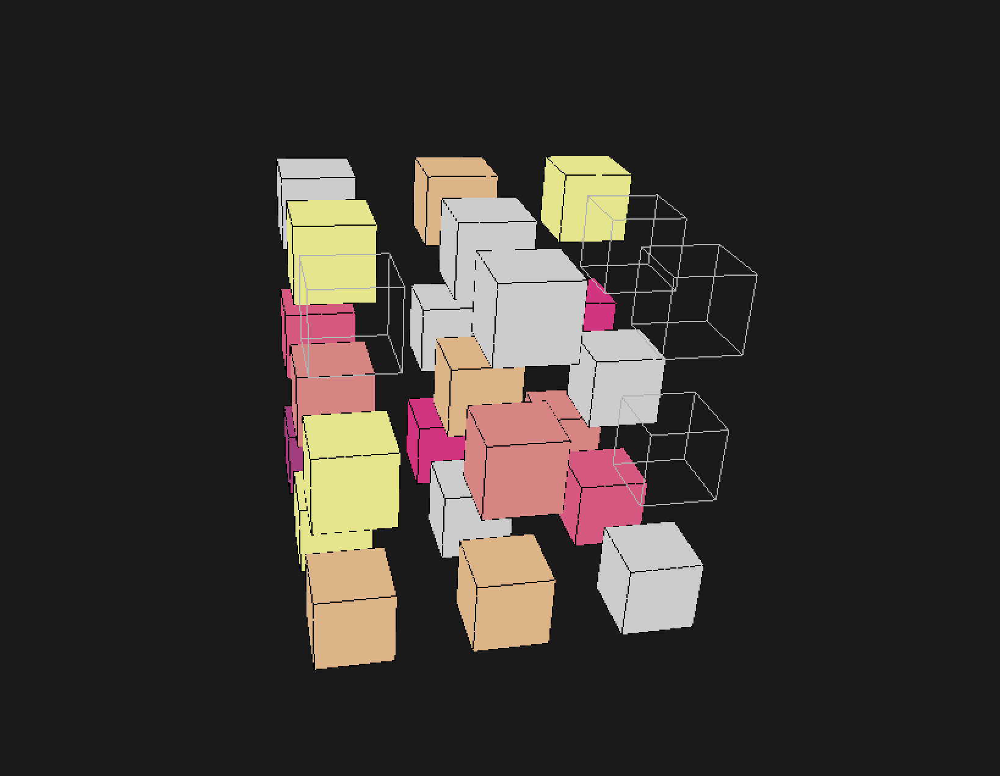
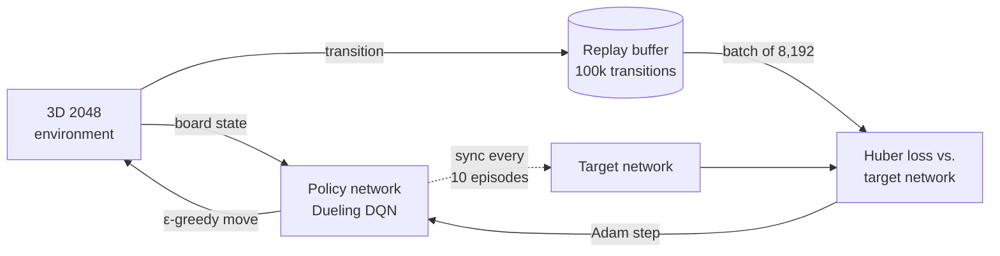
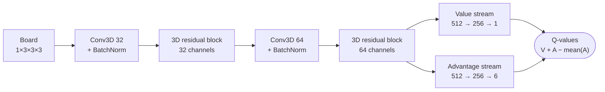

<div align="center">

# Training a Computer to Play 2048 in 3D

**A Dueling Deep Q-Network that teaches itself to play a 3×3×3 version of 2048,<br/>with a real-time 3D viewer to watch the trained agent play.**




<sub>The trained agent mid-game in the 3D viewer. Colored cubes are tiles (color encodes value); wireframes are empty cells.</sub>

</div>

## Highlights

| 🏆 Agent vs. human | 🧊 Game | 🧠 Network | 🔁 Training |
| :---: | :---: | :---: | :---: |
| **~3×** | **27 cells · 6 moves** | **2.4M params** | **~500 episodes** |
| an experienced human player's score, in under 10 seconds of play | up to ~10²⁹ board configurations | 3D residual CNN with dueling heads | experience replay + target network |

## The game

Classic 2048 is played on a 4×4 grid. This project moves it into three dimensions: a 3×3×3 cube where every move slides all tiles along one of three axes. Equal tiles merge and double, a new tile (2 with 90% probability, otherwise 4) appears after every move, and the game ends when a 2048 tile is made or no move is left.

| Key | Move | Axis |
| :---: | --- | --- |
| `A` / `D` | left / right | horizontal |
| `W` / `S` | up / down | vertical |
| `Q` / `E` | away / toward | depth |

Twice as many moves and a deeper board than the original make planning much harder, which is what makes it a good reinforcement-learning problem. Original 2048 by [Gabriele Cirulli](https://github.com/gabrielecirulli/2048).

## How the agent learns



### Network architecture



### Design choices

- **3D convolutions with residual blocks** see merge patterns along all three axes at once, instead of flattening the cube and losing its geometry.
- **Dueling heads** estimate how good a board is separately from how much each move adds, which steadies Q-values when several moves are about equally good.
- **Log-scaled input**: each tile is encoded as log2(value) / 11, so an empty cell is 0, a 2048 tile is 1, and every doubling is an equal step.
- **Reward shaping**: the merge score, plus a bonus of 10 × log2(tile) whenever a new highest tile appears, and a penalty of −1 for a move that changes nothing.
- **Action masking at play time**: the agent only chooses among moves that actually change the board.
- **Training stability**: target network synced every 10 episodes, Huber loss, gradient clipping at 1.0, Adam with weight decay, and no dropout in the Q-heads.
- **Built for speed**: a pre-allocated NumPy replay buffer and input tensor avoid per-step memory allocation, and a built-in profiler times each phase of the training loop.

### Hyperparameters

| Parameter | Value |
| --- | --- |
| Batch size | 8,192 |
| Replay buffer | 100,000 transitions |
| Discount factor γ | 0.99 |
| Learning rate | 1e-4 (Adam, weight decay 1e-5) |
| Exploration ε | 1.0 → 0.01, × 0.995 per episode |
| Target network update | every 10 episodes |
| Training length | ~500 episodes, checkpoint every 10 |

## Quick start

```bash
git clone https://github.com/charleswei2003/Training-a-Computer-to-Play-2048-in-3D.git
cd Training-a-Computer-to-Play-2048-in-3D
pip install -r requirements.txt

python playable_game.py      # play 3D 2048 yourself in the terminal
python execute_training.py   # train an agent (or resume from a checkpoint)
python execute_testing.py    # let a trained agent play and report its scores
python visualize_game.py     # watch the agent play in real-time 3D
```

Trained checkpoints are too large for GitHub and are available on [Google Drive](https://drive.google.com/drive/folders/1L27GUpmwOVPkFXj1C2p-MhDYwcXUKvj-?usp=sharing). Put a `checkpoint_episode_###.pth` file in the repository root and set the checkpoint at the top of each script; `visualize_game.py` loads episode 340 by default.

## Repository structure

| File | Purpose |
| --- | --- |
| [`game_implementation.py`](game_implementation.py) | 3D 2048 environment: moves, merges, rewards, valid-move check |
| [`model_construction.py`](model_construction.py) | Dueling DQN, 3D residual blocks, replay buffer, agent |
| [`training.py`](training.py) | Training loop with checkpointing, profiling and a simulation mode for analysis |
| [`testing.py`](testing.py) | Lets a trained agent play full games and summarizes the results |
| [`visualize_game.py`](visualize_game.py) | Real-time 3D rendering of the agent's games with Pygame and OpenGL |
| [`playable_game.py`](playable_game.py) | Human-playable version in the terminal |
| [`execute_training.py`](execute_training.py) | Training entry point; plots score, running average and highest tile per episode |
| [`execute_testing.py`](execute_testing.py) | Testing entry point; loads a checkpoint and plays a set number of games |

## Team

Built by a six-person team led by [Zizhan (Charles) Wei](https://github.com/charleswei2003) ([LinkedIn](https://www.linkedin.com/in/charles-z-wei)).
